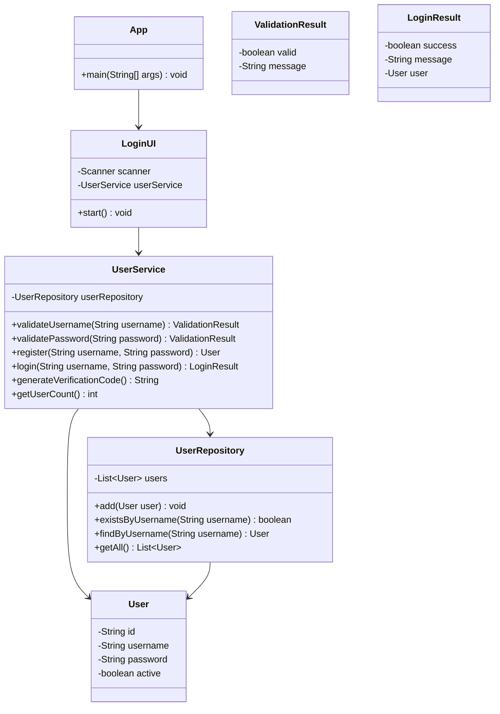

# TextFightingGameCodex 项目文档

## 1. 项目概述

`TextFightingGameCodex` 是一个基于 Java 控制台的文字游戏项目，当前版本已经完成了账号系统的基础重构，采用了分层设计，为后续接入“文字战斗”“角色成长”“背包道具”“关卡事件”等核心玩法提供了清晰的扩展基础。

当前代码重点解决的是以下问题：

- 将原本集中在一个类中的职责拆分为入口层、界面层、业务层、仓储层和实体层。
- 提供注册、登录、验证码、用户合法性校验等基础能力。
- 建立更容易维护和扩展的项目结构，减少后续战斗系统接入时的耦合。

需要明确的是：当前项目还处于“账号系统和整体框架搭建完成、战斗玩法尚未落地”的阶段，因此它更准确的定位是“文字战斗游戏的基础骨架版本”。

## 2. 项目目标

本项目的阶段性目标如下：

- 完成控制台文字游戏的基础启动流程。
- 支持玩家注册和登录。
- 保证用户名、密码等输入数据的基本合法性。
- 为后续战斗模块提供可扩展的架构。

后续完整目标如下：

- 增加角色属性系统，例如生命值、攻击力、防御力、等级、经验值。
- 增加敌人系统和战斗回合系统。
- 增加道具、技能、商店、背包等游戏模块。
- 增加存档与读档能力。
- 增加测试代码和异常场景验证。

## 3. 技术栈与运行环境

- 语言：Java
- 运行方式：控制台应用
- 构建方式：当前使用 `javac` 直接编译
- IDE：IntelliJ IDEA 项目结构
- 数据存储：内存存储，程序退出后数据丢失

建议运行环境：

- JDK 8 或更高版本
- 支持 UTF-8 的终端和文件编码配置

## 4. 项目目录结构

当前目录结构如下：

```text
TextFightingGameCodex/
├─ src/
│  ├─ App.java
│  ├─ domain/
│  │  └─ User.java
│  ├─ repository/
│  │  └─ UserRepository.java
│  ├─ service/
│  │  ├─ LoginResult.java
│  │  ├─ UserService.java
│  │  └─ ValidationResult.java
│  └─ ui/
│     └─ LoginUI.java
├─ .gitignore
├─ TextFightingGameCodex.iml
└─ PROJECT_DOCUMENTATION.md
```

## 5. 架构设计说明

项目采用了轻量级分层结构：

- `App`
负责程序启动和依赖装配。

- `ui`
负责和玩家进行交互，展示菜单、读取输入、输出结果。

- `service`
负责业务规则，例如注册校验、登录判定、验证码生成。

- `repository`
负责用户数据的存储和查询。

- `domain`
负责定义核心实体对象。

这种结构的优点：

- 不同职责分开，代码更容易阅读和维护。
- 后续增加新功能时，不必把所有逻辑都堆进一个类。
- 更适合后续扩展为完整游戏系统。

## 6. 类图



## 7. 核心模块说明

### 7.1 App

文件位置：
[App.java](/C:/Users/LJC/IdeaProjects/TextFightingGameCodex/src/App.java:1)

职责：

- 作为程序入口。
- 负责创建 `UserRepository`、`UserService`、`LoginUI`。
- 负责把各层依赖连接起来。

说明：

`App` 不直接处理业务逻辑，它只负责启动和装配，是典型的入口类。

### 7.2 User

文件位置：
[User.java](/C:/Users/LJC/IdeaProjects/TextFightingGameCodex/src/domain/User.java:1)

职责：

- 表示用户实体。
- 存储用户编号、用户名、密码、状态。
- 在对象创建时自动生成用户编号。

字段说明：

- `id`：用户编号，格式为 `LJC` 加 5 位随机数字。
- `username`：用户名。
- `password`：密码。
- `active`：用户是否可用。

说明：

当前 `User` 只承载账号信息，后续可以继续扩展角色名称、等级、生命值、攻击力、金币等游戏属性。

### 7.3 UserRepository

文件位置：
[UserRepository.java](/C:/Users/LJC/IdeaProjects/TextFightingGameCodex/src/repository/UserRepository.java:1)

职责：

- 存储用户对象。
- 根据用户名查找用户。
- 判断用户名是否已存在。

当前实现方式：

- 使用 `ArrayList<User>` 在内存中保存数据。

优点：

- 简单直接，适合当前练习和架构搭建阶段。

局限：

- 程序退出后数据会丢失。
- 不支持持久化和多线程场景。

### 7.4 UserService

文件位置：
[UserService.java](/C:/Users/LJC/IdeaProjects/TextFightingGameCodex/src/service/UserService.java:1)

职责：

- 校验用户名是否合法。
- 校验密码是否合法。
- 处理注册逻辑。
- 处理登录逻辑。
- 生成验证码。
- 统计当前注册用户数。

这是当前项目的业务核心层。UI 层不直接处理复杂规则，而是调用 `UserService` 获取结果。

### 7.5 ValidationResult

文件位置：
[ValidationResult.java](/C:/Users/LJC/IdeaProjects/TextFightingGameCodex/src/service/ValidationResult.java:1)

职责：

- 表示输入校验结果。
- 封装“是否合法”和“提示信息”。

这样可以避免直接返回 `true/false` 导致信息不足的问题。

### 7.6 LoginResult

文件位置：
[LoginResult.java](/C:/Users/LJC/IdeaProjects/TextFightingGameCodex/src/service/LoginResult.java:1)

职责：

- 表示登录结果。
- 封装登录是否成功、提示信息以及对应用户对象。

这样 UI 层可以根据结果决定下一步展示内容。

### 7.7 LoginUI

文件位置：
[LoginUI.java](/C:/Users/LJC/IdeaProjects/TextFightingGameCodex/src/ui/LoginUI.java:1)

职责：

- 显示主菜单。
- 读取用户输入。
- 触发注册流程。
- 触发登录流程。
- 展示业务结果。

`LoginUI` 是项目当前唯一的界面层实现。它不负责持久化，也不直接保存用户列表，而是通过 `UserService` 调用业务能力。

## 8. 程序执行流程

### 8.1 启动流程

```text
App.main()
  -> 创建 UserRepository
  -> 创建 UserService
  -> 创建 LoginUI
  -> 调用 LoginUI.start()
```

### 8.2 注册流程

```text
玩家选择注册
  -> LoginUI 读取用户名
  -> UserService.validateUsername() 校验用户名
  -> LoginUI 读取密码和确认密码
  -> UserService.validatePassword() 校验密码
  -> UserService.register() 创建 User
  -> UserRepository.add() 保存用户
  -> UI 输出注册成功信息
```

### 8.3 登录流程

```text
玩家选择登录
  -> LoginUI 读取用户名和密码
  -> UserService.generateVerificationCode() 生成验证码
  -> 玩家输入验证码
  -> 验证码正确后调用 UserService.login()
  -> UserRepository.findByUsername() 查找用户
  -> 比较密码和状态
  -> 返回 LoginResult
  -> UI 输出登录结果
```

## 9. 当前业务规则

### 9.1 用户名规则

- 长度必须在 3 到 8 个字符之间。
- 只能由字母和数字组成。
- 不能是纯数字。
- 不能与已有用户名重复。

### 9.2 密码规则

- 长度必须在 3 到 8 个字符之间。
- 只能由字母和数字组成。
- 不能是纯数字。

### 9.3 验证码规则

- 长度为 5 位。
- 其中 1 位是数字，其余位是大小写英文字母。
- 登录时要求玩家输入验证码。

## 10. 当前已实现功能

- 控制台主菜单。
- 用户注册。
- 用户登录。
- 验证码生成。
- 用户名和密码合法性校验。
- 用户唯一性校验。
- 用户编号自动生成。
- 分层架构重构。

## 11. 当前未实现功能

以下功能尚未实现，但从项目命名和设计目标来看，应当属于后续开发重点：

- 角色创建与职业选择。
- 玩家属性面板。
- 敌人生成与敌人属性。
- 回合制战斗流程。
- 普攻、技能、防御、逃跑等战斗指令。
- 胜利奖励与经验成长。
- 背包与道具系统。
- 商店系统。
- 存档与读档。
- 自动化测试。

## 12. 设计优点

- 结构比单类实现清晰得多。
- 模块职责边界明确。
- 后续扩展战斗系统时，已有基础分层可以复用。
- 登录和注册不再直接依赖底层数据结构。
- 返回结果对象的做法提升了可读性和可扩展性。

## 13. 当前风险与问题

### 13.1 文字战斗核心玩法尚未接入

虽然项目名为 `TextFightingGameCodex`，但当前版本本质上仍然是账号系统骨架，尚未进入真正的战斗游戏阶段。

### 13.2 数据仅保存在内存中

`UserRepository` 当前使用集合存储数据，程序结束后所有注册用户都会丢失。

### 13.3 缺少测试

目前没有单元测试或集成测试，业务规则只能依赖手工运行验证。

### 13.4 代码中存在中文乱码风险

当前源码里的中文提示在终端读取时出现乱码，说明文件编码、编译编码和终端编码之间存在不一致。这个问题不影响架构设计，但会影响最终用户体验。

建议统一：

- 源文件编码使用 UTF-8。
- 编译时明确使用 `-encoding UTF-8`。
- IDEA 项目编码设置为 UTF-8。
- 终端输出编码与源文件编码保持一致。

### 13.5 安全性仅适用于练习项目

密码当前为明文存储，不适合真实生产环境，仅适合教学和练习阶段。

## 14. 建议的后续开发路线

建议按以下顺序推进：

### 第一阶段：补齐游戏主循环

- 新增 `GameService`
- 新增 `GameUI`
- 登录成功后进入游戏主菜单
- 支持开始战斗、查看角色、退出登录

### 第二阶段：建立战斗系统

- 新增 `Character`、`Player`、`Enemy` 实体
- 新增 `BattleService`
- 实现回合制文本战斗
- 增加伤害计算、胜负判定

### 第三阶段：建立成长系统

- 增加经验值、等级、属性成长
- 增加敌人掉落奖励
- 增加装备和道具

### 第四阶段：建立存档系统

- 将 `UserRepository` 替换为文件存储或数据库存储
- 支持用户数据持久化
- 支持角色存档

### 第五阶段：补充测试与异常处理

- 为 `UserService` 增加单元测试
- 为登录和注册流程增加集成测试
- 处理输入异常、空输入、边界输入等场景

## 15. 运行说明

### 编译

在项目根目录执行：

```powershell
javac -encoding UTF-8 -d out (Get-ChildItem -Recurse -File src\*.java | ForEach-Object { $_.FullName })
```

### 运行

```powershell
java -cp out App
```

## 16. 评审结论建议

如果从“重构质量”角度审核，这个版本是合格的，因为它已经完成了从单体 UI 逻辑向分层结构的迁移，具备继续扩展的基础。

如果从“完整文字战斗游戏”角度审核，这个版本还不完整，因为核心玩法模块尚未实现。

因此更准确的评审结论建议写法是：

- 架构重构方向正确。
- 账号系统基础能力已经具备。
- 项目已形成可扩展骨架。
- 但战斗系统、成长系统和持久化系统仍需继续开发。

## 17. 可选的下一步文档

如果需要继续完善项目文档，建议下一步补充以下材料：

- 《详细设计文档》
- 《类图与时序图文档》
- 《战斗系统设计文档》
- 《测试用例文档》
- 《版本迭代计划》

---

本文档基于当前 `TextFightingGameCodex` 项目实际代码编写，适合作为课程作业审阅稿、阶段性汇报稿或后续迭代开发说明书。
